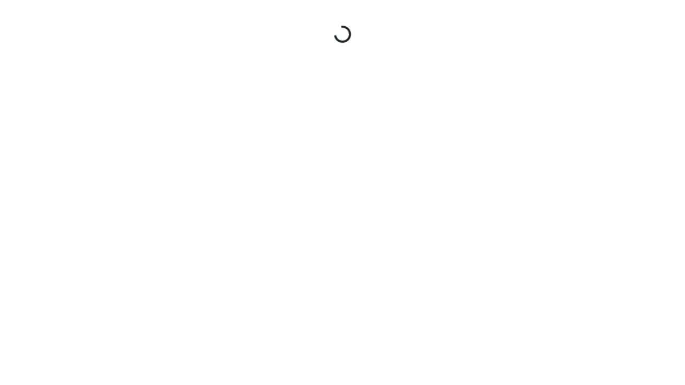

# Evidencia: bloqueo UI→API

- Caso: `tests/ui/booking-ui-api.spec.ts`.
- Ejecución: `npm test`, 2 workers; 3 passed, 1 failed, código de salida 1.
- Resultado: al navegar a la reserva, la página permanece en el spinner; no se encuentra el heading `Book This Room` y el flujo no llega al formulario ni crea una reserva.
- Contraste del demo: `GET /api/room/1` y `GET /api/report/room/1` devolvieron HTTP 500; `GET /api/branding` devolvió HTTP 200.
- Acción: conservar la prueba fallida; investigar el servicio demo antes de reejecutar. No se usaron mocks ni se relajó la aserción.

Screenshot capturado por Playwright:

El HTML report, video y trace completos están en `playwright-report/` y `test-results/` en el workspace local. No se publican completos porque los traces pueden contener headers/datos de requests y deben revisarse antes de compartir.
